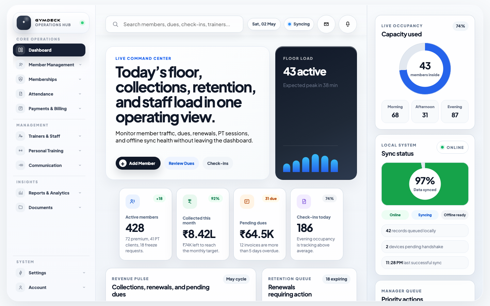
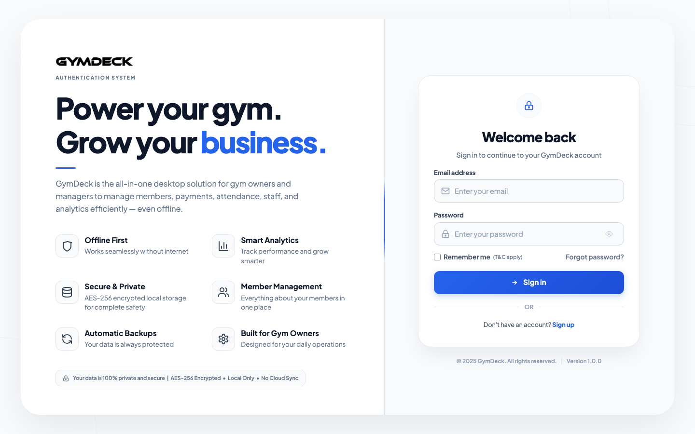
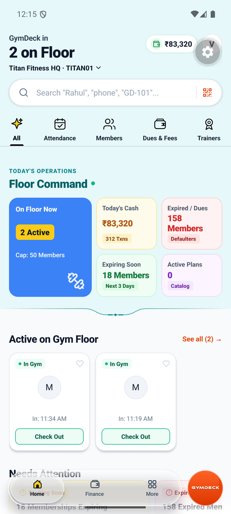
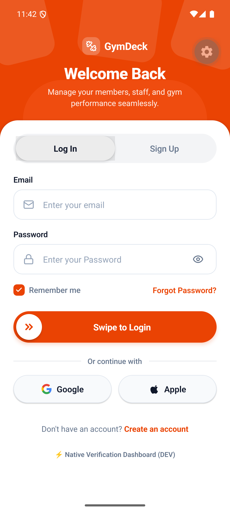

<div align="center">

```
  ██████╗ ██╗   ██╗███╗   ███╗██████╗ ███████╗ ██████╗██╗  ██╗
  ██╔════╝ ╚██╗ ██╔╝████╗ ████║██╔══██╗██╔════╝██╔════╝██║ ██╔╝
  ██║  ███╗ ╚████╔╝ ██╔████╔██║██║  ██║█████╗  ██║     █████═╝ 
  ██║   ██║  ╚██╔╝  ██║╚██╔╝██║██║  ██║██╔══╝  ██║     ██╔═██╗ 
  ╚██████╔╝   ██║   ██║ ╚═╝ ██║██████╔╝███████╗╚██████╗██║ ╚██╗
   ╚═════╝    ╚═╝   ╚═╝     ╚═╝╚═════╝ ╚══════╝ ╚═════╝╚═╝  ╚═╝
```

### **The Unified Offline-First ERP · Cloud-Synchronized Gateway · Bento AI Mobile Ecosystem**

<p align="center">
  <a href="https://github.com/epicstudiohelpdesk-arch/GYMDECK/actions/workflows/build-macos.yml"></a>
  <a href="https://github.com/epicstudiohelpdesk-arch/GYMDECK/actions/workflows/build-linux.yml"></a>
  <a href="https://github.com/epicstudiohelpdesk-arch/GYMDECK/actions/workflows/build-windows.yml"></a>
  <a href="https://github.com/epicstudiohelpdesk-arch/GYMDECK/actions/workflows/backend-ci.yml"></a>
  <a href="https://github.com/epicstudiohelpdesk-arch/GYMDECK/actions/workflows/mobile-ci.yml"></a>
</p>

<p align="center">
  
  
  
  
  
</p>

---

> **System Specification Invariant:**  
> *"Local-first. Cloud-synchronized. Server-authorized."*  
> 
> **Core Operational Law:**  
> *"The gym creates the member. The member creates the digital account. GymDeck Cloud securely links the two."*  
> 
> **Architectural Blueprint:** [`docs/architecture/SYSTEM-SPECIFICATION.md`](docs/architecture/SYSTEM-SPECIFICATION.md)

</div>

---

## Tri-Platform Command Center Showcase

<div align="center">
  <p><b>GymDeck delivers an integrated, real-time control cockpit across native Desktop ERP, Owner Mobile Management, and Member Mobile Bento apps.</b></p>
</div>

### 1. Desktop ERP Operations Hub (Tauri v2 + Rust Core + React 19)
The high-throughput mission control center for front-desk operators and gym managers. Operates with zero cloud latency via **SQLCipher AES-256** local database with background multi-threaded delta sync.

<div align="center">
  
  <p><i>Live Floor Capacity Meter • Asynchronous Offline Sync Pulse • Real-Time Revenue Metrics • Active Member Roster • 36 Modular Stages</i></p>
</div>

<div align="center">
  <table>
    <tr>
      <td align="center" width="50%">
        <b>Desktop Live Operations Dashboard</b><br/><br/>
        
      </td>
      <td align="center" width="50%">
        <b>Desktop Biometric & Keyring Security Gate</b><br/><br/>
        
      </td>
    </tr>
  </table>
</div>

---

### 2. Owner Mobile Management Suite vs. Member Mobile Bento Experience

<div align="center">
  <table>
    <tr>
      <th colspan="2" align="center" style="background-color: #0F172A; color: #F8FAFC;">
        <b>GYMDECK OWNER MOBILE MANAGEMENT SUITE</b>
      </th>
      <th colspan="2" align="center" style="background-color: #1E293B; color: #F8FAFC;">
        <b>GYMDECK MEMBER MOBILE BENTO APP</b>
      </th>
    </tr>
    <tr>
      <td align="center" width="25%">
        <b>Floor Command & Cash Pulse</b><br/>
        <sub>Live turnstile headcounts & daily cash</sub><br/><br/>
        
      </td>
      <td align="center" width="25%">
        <b>Biometric Swipe-to-Auth</b><br/>
        <sub>Curved brand header & staff auth</sub><br/><br/>
        
      </td>
      <td align="center" width="25%">
        <b>Bento Home Experience</b><br/>
        <sub>Live occupancy & macro trackers</sub><br/><br/>
        
      </td>
      <td align="center" width="25%">
        <b>Dynamic Turnstile QR Pass</b><br/>
        <sub>30-second HMAC anti-replay pass</sub><br/><br/>
        
      </td>
    </tr>
    <tr>
      <td align="center">
        <b>Member Roster & Dues</b><br/>
        <sub>Direct check-out, fee collection</sub>
      </td>
      <td align="center">
        <b>Vault Isolation</b><br/>
        <sub>Tenant encrypted key verification</sub>
      </td>
      <td align="center">
        <b>AI Workouts & Pose Coach</b><br/>
        <sub>Edge CV 33-point form analysis</sub>
      </td>
      <td align="center">
        <b>Active Plan Ledger</b><br/>
        <sub>Tier benefits & renewal status</sub>
      </td>
    </tr>
  </table>
</div>

---

### 3. Member Mobile Edge AI & Lifestyle Modules

<div align="center">
  <table>
    <tr>
      <td align="center" width="50%">
        <b>AI Workout Suite & Pose Kinematics</b><br/>
        <sub>33 skeletal landmark angle tracking • Rep cadence count</sub><br/><br/>
        
      </td>
      <td align="center" width="50%">
        <b>Digital Membership Ledger & Benefits</b><br/>
        <sub>Tier status • Grace period tracker • Instant digital renewal</sub><br/><br/>
        
      </td>
    </tr>
  </table>
</div>

---

## Engineered Tech Desk (Technology Matrix)

<div align="center">

<p align="center">
  <a href="https://skillicons.dev">
    
  </a>
</p>

</div>

### 1. Core Native Systems & Desktop Runtime
| Technology | Role & Architecture | Version / Spec | Status |
|:---|:---|:---|:---:|
|  | Zero-cost abstractions, multi-threaded write engine, memory safety | `1.77+` | `● Active` |
|  | Native desktop window shell, cross-platform IPC bridge | `v2.10.3` | `● Verified` |
|  | AES-256 encrypted local database, WAL mode, 15-connection pool | `0.31` | `● Production` |
|  | Vendored cryptographic primitives for SQLCipher CBC encryption | `v3.0.x` | `● Secured` |
|  | Multi-threaded async runtime, mpsc channel write workers | `v1.37` | `● Active` |
|  | Memory-hard password hashing (64MB RAM, 3 iterations, 4 parallelism) | `v0.5.3` | `● Enforced` |
|  | Cryptographic memory wiper for passwords and tokens on `Drop` | `v1.8` | `● Enforced` |
|  | 5-phase server-side PDF stream deduplication and image downscaler | `v0.33` | `● Production` |

### 2. Mobile Engineering Suite (Owner & Member)
| Technology | Role & Architecture | Version / Spec | Status |
|:---|:---|:---|:---:|
|  | High-performance native mobile UI rendering framework | `0.88.1` | `● Active` |
|  | Cross-platform managed native runtime with Expo Router v4 | `SDK 58` | `● Verified` |
|  | Strict compile-time typing across routes, stores, and AI models | `v5.3+` | `● 0 Errors` |
|  | Utility-first Bento design system styling for React Native | `v4.0` | `● Active` |
|  | Micro-state management for theme, nutrition logs, and user auth | `v4.5` | `● Active` |
|  | Edge-to-edge scaling for Dynamic Island, notch, and Android bars | `v5.10` | `● Responsive` |
|  | Dynamic turnstile pass generation with 30s auto-refresh cycles | `crypto-js` | `● Secured` |

### 3. Edge AI / ML Computer Vision Engine
| Technology | Role & Architecture | Version / Spec | Status |
|:---|:---|:---|:---:|
|  | Model training, ONNX graph export, and dataset preprocessing | `3.11+` | `● Active` |
|  | Deep neural network training for equipment & food classification | `v2.2` | `● Verified` |
|  | Real-time 33-point skeletal landmark detection on device | `v0.10` | `● Edge Ready` |
|  | Frame normalization, bounding-box cropping, perspective correction | `v4.9` | `● Active` |
|  | Semantic food item segmentation, macro & micronutrient estimation | `In-house` | `● Active` |
|  | Machine identification, targeted muscle maps, safety & alternative cues | `In-house` | `● Active` |
|  | Real-time trigonometric joint angle calculation and rep cadence counting | `In-house` | `● Active` |
|  | 1,300+ indexed strength exercises categorized by body part & equipment | `v1.2` | `● Integrated` |

### 4. Cloud Gateway, Microservices & Synchronization
| Technology | Role & Architecture | Version / Spec | Status |
|:---|:---|:---|:---:|
|  | High-throughput asynchronous backend runtime | `v22 LTS` | `● Active` |
|  | Enterprise REST gateway and route coordination | `v5.2` | `● Active` |
|  | Cloud database with row-level locks for turnstile gate serialization | `v16 Alpine` | `● Scalable` |
|  | Multi-stage production container build with minimal attack surface | `v26+` | `● Containerized` |
|  | Runtime request body and query schema contract enforcement | `v3.23` | `● Enforced` |
|  | Bi-directional offline reconciliation supporting 3-arg & 4-arg handshakes | `Custom` | `● Operational` |
|  | Direct bank settlement, simulated SMS OTP verification, and VPA routing | `Custom` | `● Integrated` |

---

## Tri-Tier Engineering Architecture

```
┌─────────────────────────────────────────────────────────────────────────────────────────┐
│                           GYMDECK TRI-TIER TOPOLOGY BLUEPRINT                           │
└─────────────────────────────────────────────────────────────────────────────────────────┘
                                             │
                   ┌─────────────────────────┴─────────────────────────┐
                   ▼                                                   ▼
┌─────────────────────────────────────┐               ┌─────────────────────────────────────┐
│      TIER 1: FRONT-DESK ERP         │               │    TIER 2: OWNER & MEMBER MOBILE    │
│      (Tauri v2 + Rust Core)         │               │     (React Native + Expo SDK 58)    │
│                                     │               │                                     │
│  ┌───────────────────────────────┐  │               │  ┌───────────────────────────────┐  │
│  │ React 19 Frontend Shell       │  │               │  │ Owner Suite: Floor Command,   │  │
│  │ 36 Lazy-Loaded Admin Stages   │  │               │  │ Member Dues, Attendance Logs  │  │
│  └──────────────┬────────────────┘  │               │  ├───────────────────────────────┤  │
│                 │ IPC Commands      │               │  │ Member Suite: Bento Dashboard,│  │
│  ┌──────────────▼────────────────┐  │               │  │ HMAC QR Pass, AI Pose Coach   │  │
│  │ Rust Native Engine            │  │               │  └───────────────┬───────────────┘  │
│  │ - SQLCipher AES-256 DB        │  │               │                  │                  │
│  │ - Dedicated Write Worker      │  │               │  ┌───────────────▼───────────────┐  │
│  │ - Argon2id Cryptography       │  │               │  │ Edge AI Computer Vision       │  │
│  │ - 5-Phase PDF Optimizer       │  │               │  │ - Calorie & Macro Vision      │  │
│  │ - Daily 3:00 AM VACUUM        │  │               │  │ - Gym Equipment Classifier    │  │
│  └──────────────┬────────────────┘  │               │  │ - 33-Point Pose Kinematics    │  │
│                 │                   │               │  └───────────────┬───────────────┘  │
└─────────────────┼───────────────────┘               └──────────────────┼──────────────────┘
                  │                                                      │
                  │ Asynchronous Delta Sync Hub                          │ HTTPS REST / HMAC Pass
                  ▼                                                      ▼
┌─────────────────────────────────────────────────────────────────────────────────────────┐
│                      TIER 3: CLOUD GATEWAY & CONCURRENCY ORCHESTRATOR                   │
│  ┌─────────────────────────┐ ┌─────────────────────────┐ ┌───────────────────────────┐  │
│  │ Multi-Tenant Sync Hub   │ │ Turnstile Gate Lock     │ │ Payment Orchestration     │  │
│  │ Delta Conflict Matrix   │ │ Concurrent Check-Ins    │ │ Razorpay / Stripe / UPI QR│  │
│  └─────────────────────────┘ └─────────────────────────┘ └───────────────────────────┘  │
└─────────────────────────────────────────────────────────────────────────────────────────┘
```

---

## Bento Light-Theme Color Geometry

```
┌────────────────────────────────────────────────────────────────────────┐
│                      BENTO PALETTE SPECIFICATIONS                      │
├───────────────────┬─────────────┬──────────────────────────────────────┤
│ Token Name        │ Hex Code    │ Visual Role & Usage                  │
├───────────────────┼─────────────┼──────────────────────────────────────┤
│ Periwinkle Primary│ #4F75E3     │ Primary brand action, pill buttons   │
│ Pastel Periwinkle │ #9BB6F6     │ Hero Bento cards, soft accent fields │
│ Orchid Lilac      │ #DBA6F4     │ Quick action tiles, secondary stats  │
│ Golden Tangerine  │ #F59D42     │ Streaks, energy badges, warnings     │
│ Clean Canvas      │ #F0F2F6     │ Ultra-clean neutral background       │
│ Pure White Card   │ #FFFFFF     │ High-elevation Bento surface cards   │
│ Deep Charcoal     │ #1C1D22     │ High-contrast primary typography     │
│ Muted Slate       │ #8F92A1     │ Subtitles, micro-labels, metadata    │
└───────────────────┴─────────────┴──────────────────────────────────────┘
```

---

## Edge AI & Computer Vision Kinematics

The GymDeck AI engine (`apps/member-mobile/src/services/ai/`) delivers edge computer vision directly onto mobile hardware:

```
┌──────────────────────────────────────────────────────────────────────────┐
│                      GYMDECK AI / ML VISION ENGINE                       │
└──────────────────────────────────────────────────────────────────────────┘
       │                                     │                      │
       ▼                                     ▼                      ▼
┌──────────────────────────────┐ ┌──────────────────────────────┐ ┌──────────────────────────────┐
│  AI NUTRITION & CALORIES     │ │  AI EQUIPMENT CLASSIFIER     │ │  AI REAL-TIME POSE COACH     │
│  - Instant Camera Macro Scan │ │  - Machine Identification    │ │  - 33-Point Keypoint Math    │
│  - Multi-item Segmentation   │ │  - Targeted Muscle Groups    │ │  - Range-of-Motion (ROM)     │
│  - Calories, Protein, Carbs  │ │  - Video Guide & Steps       │ │  - Form Angle Validation     │
│  - Micronutrient Estimates   │ │  - Safety Precautions        │ │  - Rep Cadence Counter       │
│  - Daily Budget Auto-Log     │ │  - Free-Weight Alternatives  │ │  - Live Audio Correction     │
└──────────────────────────────┘ └──────────────────────────────┘ └──────────────────────────────┘
```

1. **AI Calorie & Macro Vision (`calorieVisionService.ts`)**: Instant multi-item meal plate segmentation and macro tracking into reactive stores.
2. **AI Gym Machine Classifier (`gymMachineService.ts`)**: Autonomous recognition of gym equipment with 3D anatomical target muscle mapping.
3. **Real-Time Pose Coach (`poseCoachService.ts`)**: 33-point skeletal landmark detection tracking joint angles:
   $$\theta = \arccos\left(\frac{\vec{BA} \cdot \vec{BC}}{|\vec{BA}| |\vec{BC}|}\right)$$

---

## Desktop ERP — 36 Lazy-Loaded Admin Stages

```
DashboardWidgets      CollectFees           MemberDocuments       TrainerPerformance
Agreements            DailyCheckin          MembershipGrowth      TrainerSchedule
AllTrainers           DeviceSync            PastMembers           WelcomeOverlay
AppSettings           ExpiringMemberships   Profile               RevenueReport
AssignTrainer         GymProfile            PTClients             SendNotification
AttendanceTrends      IDProofs              PTPackages            SessionTracking
BackupRestore         ManualEntry           FreezePause           StaffRoles
```

### 5-Phase Document Compression Pipeline
```
[User Selects Document / ID / Photo]
                  │
                  ▼
┌────────────────────────────────────────────────────────┐
│  CLIENT-SIDE (Canvas Engine — WebP Q75, max 1600px)    │
│  - Photo reduction: 40% to 70% size decrease           │
│  - PDFs bypassed to preserve multi-page fidelity       │
└─────────────────────────┬──────────────────────────────┘
                          │ Tauri IPC (Base64 Transfer)
                          ▼
┌────────────────────────────────────────────────────────┐
│  SERVER-SIDE (Rust PdfOptimizer — lopdf + flate2)      │
│  - Gate: Triggered if >200 KB and magic bytes = %PDF   │
│  - Phase 1: Orphan Object Pruning                      │
│  - Phase 2: Metadata & XMP Stripping                   │
│  - Phase 3: Embedded JPEG Re-Encoding (Q70, 1200px)    │
│  - Phase 4: SHA-256 Stream Deduplication               │
│  - Phase 5: Cross-Reference Stream Compression         │
└─────────────────────────┬──────────────────────────────┘
                          │
                          ▼
            [SQLCipher AES-256 BLOB Storage]
```

---

## Security, Cryptography & Compliance Matrix

| Security Domain | Mechanism | Implementation Details |
|---|---|---|
| **Database Encryption** | AES-256 (SQLCipher) | 256-bit CBC encryption with HMAC per page. Hard purge prohibited on key mismatch. |
| **Password Storage** | Argon2id & scrypt | Desktop: Argon2id (64MB/3/4). Cloud: scrypt (N=16384, r=8, p=1). Constant-time comparisons. |
| **Pass Generation** | HMAC-SHA256 Dynamic QR | Single-use time-bound tokens refreshed every 30s with anti-replay cryptographic nonces. |
| **Session Security** | OS Keyring + Keychains | Tokens stored in macOS Keychain, Windows Credential Manager, or Linux Secret Service. |
| **Memory Protection** | Zeroize on Drop | `SecureString` and cryptographic tokens zeroize their memory allocations when dropped. |
| **Brute-Force Guard** | Token-Bucket Limiter | Exponential penalty multipliers on failed attempts across auth and sensitive endpoints. |
| **Safe Error Handling** | Sanitized Serializers | Strips internal paths, queries, and cryptographic keys before error delivery. |

---

## Automated Testing & Verification

GymDeck enforces strict quality criteria across the monorepo:

### Mobile Apps TypeScript Verification
```bash
# Member Mobile App
cd apps/member-mobile && pnpm run typecheck
# Output: $ tsc --noEmit (0 errors)

# Owner Mobile App
cd apps/owner-mobile && pnpm run typecheck
# Output: $ tsc --noEmit (0 errors)
```

### Rust Security & Chaos Tests (23/23 Passing)
```bash
cd src-tauri && cargo test
```

```
23/23 tests passed (9.72s)
├── 13 Security & Enterprise Tests
│   ├── test_rate_limiter_prevents_bruteforce ............ PASSED
│   ├── test_rate_limiter_penalty_logic .................. PASSED
│   ├── test_rate_limiter_refill ......................... PASSED
│   ├── test_device_trust_fingerprint_determinism ........ PASSED
│   ├── test_trust_engine_drift_classification .......... PASSED
│   ├── test_session_create_and_revoke ................... PASSED
│   ├── test_session_lock ................................ PASSED
│   ├── test_argon2_hash_and_verify ...................... PASSED
│   ├── test_secure_string_zeroize_on_drop ............... PASSED
│   ├── test_app_config_defaults ......................... PASSED
│   ├── test_schema_migration_version_tracking ........... PASSED
│   └── test_concurrent_rate_limiter_thread_safety ....... PASSED
│
└── 10 Chaos & Resilience Tests
    ├── test_corrupted_backup_import_rejection ........... PASSED
    ├── test_schema_downgrade_detection .................. PASSED
    ├── test_incremental_vacuum_does_not_block ........... PASSED
    ├── test_panic_hook_sanitization ..................... PASSED
    ├── test_error_serialization_safety .................. PASSED
    ├── test_database_corruption_error ................... PASSED
    ├── test_rapid_fire_auth_rejection ................... PASSED
    ├── test_multi_factor_kdf_produces_different_keys .... PASSED
    ├── test_wal_mode_pragma_applies_correctly ........... PASSED
    └── test_config_production_mode_detection ............ PASSED
```

---

## Monorepo Directory Blueprint

```
GYMDECK/
├── apps/
│   ├── member-mobile/              # React Native & Expo SDK 58 Member Mobile App
│   │   ├── app/                    # Expo Router file-based screens
│   │   │   ├── (auth)/             # Login, Signup, Forgot/Reset Password, Verify OTP
│   │   │   ├── (main)/(tabs)/      # Bento Home, QR Check-In, Workouts, Membership, Profile
│   │   │   └── details/            # AI Hub, Nutrition, Machine Scanner, Pose Coach, Exercise DB
│   │   └── src/services/ai/        # Calorie Vision, Pose Tracking, Equipment Classifier
│   │
│   └── owner-mobile/               # Gym Owner / Staff companion mobile app
│       ├── app/                    # Floor Command, Members, Finance, Attendance
│       └── src/services/           # Real-time staff controls & offline cache
│
├── backend/                        # Cloud Gateway & Microservices
│   ├── gateway/                    # Express 5 / TypeScript API Gateway & Routes
│   ├── services/                   # Billing, Attendance, Sync, and Member services
│   ├── shared/                     # SQL schemas, database bootstraps, and types
│   └── workers/                    # Background jobs and notification queues
│
├── frontend/                       # Desktop React 19 Frontend (Tauri WebView)
│   ├── *.jsx (36 stages)           # Lazy-loaded admin views (CollectFees, DailyCheckin, etc.)
│   ├── index.html                  # Desktop shell entrypoint
│   └── script.js                   # Navigation coordinator and stage registry
│
├── src-tauri/                      # Native Rust Desktop Core
│   ├── src/
│   │   ├── commands/               # Tauri IPC business & auth commands
│   │   ├── database/               # SQLCipher manager, migrations, async write worker
│   │   ├── encryption/             # Argon2id, SecureString zeroize wrappers
│   │   ├── sessions/               # OS Keyring manager and device trust engine
│   │   └── utils/                  # lopdf PDF compression pipeline
│   └── Cargo.toml
│
├── docs/assets/screenshots/        # High-res verified application screenshots
├── infrastructure/                 # Docker, Traefik, and deployment configurations
├── package.json                    # Workspace root scripts
└── pnpm-workspace.yaml             # pnpm workspace definition
```

---

## Quickstart & Developer Cockpit

### Prerequisites
- **Node.js:** `v20.0.0+` or `v22 LTS`
- **pnpm:** `v9.0.0+` (`npm install -g pnpm`)
- **Rust & Cargo:** `1.77+` ([rustup.rs](https://rustup.rs/))
- **Mobile Environment:** [Expo Go](https://expo.dev/go) on iOS/Android, Xcode, or Android Studio

```bash
# 1. Clone repository
git clone https://github.com/epicstudiohelpdesk-arch/GYMDECK.git
cd GYMDECK

# 2. Install monorepo dependencies
pnpm install

# 3. Launch Member Mobile App
cd apps/member-mobile && npx expo start

# 4. Launch Owner Mobile App
cd apps/owner-mobile && npx expo start

# 5. Launch Desktop ERP (Tauri + Rust)
pnpm run tauri dev

# 6. Launch Cloud Gateway
cd backend/gateway && pnpm run dev
```

---

<div align="center">

### Built with precision for modern athletic facilities, gym owners, and fitness communities worldwide.

**GymDeck Engineering Team** • [Report Issues](https://github.com/epicstudiohelpdesk-arch/GYMDECK/issues) • [View Architecture Docs](docs/architecture/SYSTEM-SPECIFICATION.md)

</div>