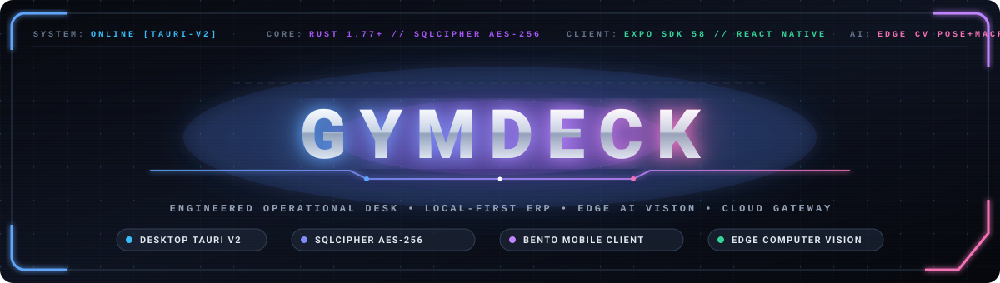

<div align="center">



```
  ██████╗ ██╗   ██╗███╗   ███╗██████╗ ███████╗ ██████╗██╗  ██╗
 ██╔════╝ ╚██╗ ██╔╝████╗ ████║██╔══██╗██╔════╝██╔════╝██║ ██╔╝
 ██║  ███╗ ╚████╔╝ ██╔████╔██║██║  ██║█████╗  ██║     █████═╝ 
 ██║   ██║  ╚██╔╝  ██║╚██╔╝██║██║  ██║██╔══╝  ██║     ██╔═██╗ 
 ╚██████╔╝   ██║   ██║ ╚═╝ ██║██████╔╝███████╗╚██████╗██║ ╚██╗
  ╚═════╝    ╚═╝   ╚═╝     ╚═╝╚═════╝ ╚══════╝ ╚═════╝╚═╝  ╚═╝
 =============================================================
       E T H N O C E N T R I C   E N G I N E E R I N G
```

### **The Unified Offline-First ERP · Cloud-Synchronized Gateway · Bento AI Mobile Ecosystem**

<p align="center">
  <a href="https://github.com/epicstudiohelpdesk-arch/GYMDECK/actions/workflows/build-macos.yml"></a>
  <a href="https://github.com/epicstudiohelpdesk-arch/GYMDECK/actions/workflows/build-linux.yml"></a>
  <a href="https://github.com/epicstudiohelpdesk-arch/GYMDECK/actions/workflows/build-windows.yml"></a>
  <a href="https://github.com/epicstudiohelpdesk-arch/GYMDECK/actions/workflows/backend-ci.yml"></a>
  <a href="https://github.com/epicstudiohelpdesk-arch/GYMDECK/actions/workflows/mobile-ci.yml"></a>
</p>

<p align="center">
  
  
  
  
  
</p>

---

> 🏛️ **System Specification Invariant:**  
> *"Local-first. Cloud-synchronized. Server-authorized."*  
> 
> ⚡ **Core Operational Law:**  
> *"The gym creates the member. The member creates the digital account. GymDeck Cloud securely links the two."*  
> 
> 📄 **Architectural Blueprint:** [`docs/architecture/SYSTEM-SPECIFICATION.md`](docs/architecture/SYSTEM-SPECIFICATION.md)

</div>

---

## 🛠️ The Engineered Tech Desk (Full Technology Matrix)

<div align="center">

<p align="center">
  <a href="https://skillicons.dev">
    
  </a>
</p>

</div>

### 1. 🦀 Core Native Systems & Desktop Runtime
| Technology | Role & Architecture | Version / Spec | Status |
|:---|:---|:---|:---:|
|  **Rust** | Zero-cost abstractions, multi-threaded write engine, memory safety | `1.77+` | `● Active` |
|  **Tauri v2** | Native desktop window shell, cross-platform IPC bridge | `v2.10.3` | `● Verified` |
|  **SQLCipher** | AES-256 encrypted local database, WAL mode, 15-connection pool | `0.31` | `● Production` |
|  **OpenSSL 3.0** | Vendored cryptographic primitives for SQLCipher CBC encryption | `v3.0.x` | `● Secured` |
| ⚡ **Tokio Async** | Multi-threaded async runtime, mpsc channel write workers | `v1.37` | `● Active` |
| 🛡️ **Argon2id** | Memory-hard password hashing (64MB RAM, 3 iterations, 4 parallelism) | `v0.5.3` | `● Enforced` |
| 🔒 **Zeroize** | Cryptographic memory wiper for passwords and tokens on `Drop` | `v1.8` | `● Enforced` |
| 📄 **lopdf + flate2** | 5-phase server-side PDF stream deduplication and image downscaler | `v0.33` | `● Production` |

### 2. 📱 Mobile Engineering Suite (iOS & Android)
| Technology | Role & Architecture | Version / Spec | Status |
|:---|:---|:---|:---:|
|  **React Native** | High-performance native mobile UI rendering framework | `0.74+` | `● Active` |
|  **Expo SDK** | Managed cross-platform native runtime with Expo Router v3 | `SDK 54 / 58` | `● Verified` |
|  **TypeScript** | Strict compile-time typing across routes, stores, and AI models | `v5.3+` | `● 0 Errors` |
|  **NativeWind** | Utility-first Bento design system styling for React Native | `v4.0` | `● Active` |
| 🐻 **Zustand** | Micro-state management for theme, nutrition logs, and user auth | `v4.5` | `● Active` |
| 🛡️ **Safe Area Context** | Edge-to-edge scaling for Dynamic Island, notch, and Android bars | `v4.10` | `● Responsive` |
| 🎟️ **HMAC QR Engine** | Dynamic turnstile pass generation with 30s auto-refresh cycles | `crypto-js` | `● Secured` |

### 3. 🧠 Edge AI / ML Computer Vision Engine
| Technology | Role & Architecture | Version / Spec | Status |
|:---|:---|:---|:---:|
|  **Python** | Model training, ONNX graph export, and dataset preprocessing | `3.11+` | `● Active` |
|  **PyTorch** | Deep neural network training for equipment & food classification | `v2.2` | `● Verified` |
|  **MediaPipe** | Real-time 33-point skeletal landmark detection on device | `v0.10` | `● Edge Ready` |
|  **OpenCV** | Frame normalization, bounding-box cropping, perspective correction | `v4.9` | `● Active` |
| 🥗 **Calorie Vision** | Semantic food item segmentation, macro & micronutrient estimation | `In-house` | `● Active` |
| 🏋️ **Gym Classifier** | Machine identification, targeted muscle maps, safety & alternative cues | `In-house` | `● Active` |
| 📐 **Pose Kinematics** | Real-time trigonometric joint angle calculation and rep cadence counting | `In-house` | `● Active` |
| 📚 **ExerciseDB API** | 1,300+ indexed strength exercises categorized by body part & equipment | `v1.2` | `● Integrated` |

### 4. ☁️ Cloud Gateway, Microservices & Synchronization
| Technology | Role & Architecture | Version / Spec | Status |
|:---|:---|:---|:---:|
|  **Node.js** | High-throughput asynchronous backend runtime | `v22 LTS` | `● Active` |
|  **Express.js** | Enterprise REST gateway and route coordination | `v5.2` | `● Active` |
|  **PostgreSQL** | Cloud database with row-level locks for turnstile gate serialization | `v16 Alpine` | `● Scalable` |
|  **Docker** | Multi-stage production container build with minimal attack surface | `v26+` | `● Containerized` |
| 🛡️ **Zod** | Runtime request body and query schema contract enforcement | `v3.23` | `● Enforced` |
| 🔄 **Delta Sync** | Bi-directional offline reconciliation supporting 3-arg & 4-arg handshakes | `Custom` | `● Operational` |
| 💳 **NPCI / UPI Switch** | Direct bank settlement, simulated SMS OTP verification, and VPA routing | `Custom` | `● Integrated` |

### 5. 🖥️ Desktop Frontend WebView (React 19 Shell)
| Technology | Role & Architecture | Version / Spec | Status |
|:---|:---|:---|:---:|
|  **React 19** | Desktop UI shell utilizing `createRoot` and `unmount()` lifecycle | `19.2.5` | `● Active` |
|  **Vite 6** | Bundler with manual chunk splitting producing 47 code-split chunks | `v6.4.2` | `● Optimized` |
| ⚡ **Terser** | Multi-pass JavaScript minifier (`drop_console`, `passes: 3`) | `v5.46` | `● Production` |
| 🎭 **Framer Motion** | Desktop animation engine for smooth stage transitions | `v12.38` | `● Active` |
| ✨ **Lottie React** | Vector animation rendering for welcome overlays and loader screens | `v2.4` | `● Active` |
| 🎛️ **Lucide Icons** | Clean, scalable engineering iconography across all 36 stages | `v0.468` | `● Active` |

---

## 📱 Mobile App Showcase & Bento Design System

The **GymDeck Member Mobile App** (`apps/member-mobile`) features a custom **Light-Theme Bento Design System** engineered for fluid responsiveness on both **iOS** (Dynamic Island & notch safe areas) and **Android** (navigation bars & display cutouts).

<div align="center">
  <table>
    <tr>
      <td align="center" width="25%">
        <b>🏠 Bento Home Dashboard</b><br/><br/>
        
      </td>
      <td align="center" width="25%">
        <b>🎟️ Turnstile QR Pass</b><br/><br/>
        
      </td>
      <td align="center" width="25%">
        <b>💪 Workouts & Routines</b><br/><br/>
        
      </td>
      <td align="center" width="25%">
        <b>💳 Membership & Dues</b><br/><br/>
        
      </td>
    </tr>
  </table>
</div>

### 🎨 Bento Light-Theme Color Geometry

```
┌────────────────────────────────────────────────────────────────────────┐
│                      BENTO PALETTE SPECIFICATIONS                      │
├───────────────────┬─────────────┬──────────────────────────────────────┤
│ Token Name        │ Hex Code    │ Visual Role & Usage                  │
├───────────────────┼─────────────┼──────────────────────────────────────┤
│ Periwinkle Primary│ #4F75E3     │ Primary brand action, pill buttons   │
│ Pastel Periwinkle │ #9BB6F6     │ Hero Bento cards, soft accent fields │
│ Orchid Lilac      │ #DBA6F4     │ Quick action tiles, secondary stats  │
│ Golden Tangerine  │ #F59D42     │ Streaks, energy badges, warnings     │
│ Clean Canvas      │ #F0F2F6     │ Ultra-clean neutral background       │
│ Pure White Card   │ #FFFFFF     │ High-elevation Bento surface cards   │
│ Deep Charcoal     │ #1C1D22     │ High-contrast primary typography     │
│ Muted Slate       │ #8F92A1     │ Subtitles, micro-labels, metadata    │
└───────────────────┴─────────────┴──────────────────────────────────────┘
```

---

## 🏛️ Tri-Tier Engineering Architecture

```
┌─────────────────────────────────────────────────────────────────────────────────────────┐
│                           GYMDECK TRI-TIER TOPOLOGY BLUEPRINT                           │
└─────────────────────────────────────────────────────────────────────────────────────────┘
                                             │
                  ┌──────────────────────────┴──────────────────────────┐
                  ▼                                                     ▼
┌───────────────────────────────────┐                 ┌───────────────────────────────────┐
│     TIER 1: FRONT-DESK ERP        │                 │     TIER 2: MEMBER MOBILE         │
│     (Tauri v2 + Rust Core)        │                 │     (React Native + Expo SDK)     │
│                                   │                 │                                   │
│  ┌─────────────────────────────┐  │                 │  ┌─────────────────────────────┐  │
│  │ React 19 Frontend Shell     │  │                 │  │ Light Bento Design System   │  │
│  │ 36 Lazy-Loaded Admin Stages │  │                 │  │ Floating Bottom Nav Dock    │  │
│  └──────────────┬──────────────┘  │                 │  └──────────────┬──────────────┘  │
│                 │ IPC Commands    │                 │                 │                 │
│  ┌──────────────▼──────────────┐  │                 │  ┌──────────────▼──────────────┐  │
│  │ Rust Native Engine          │  │                 │  │ Edge AI Computer Vision     │  │
│  │ - SQLCipher AES-256 DB      │  │                 │  │ - Calorie & Macro Scanner   │  │
│  │ - Dedicated Write Worker    │  │                 │  │ - Gym Equipment Classifier  │  │
│  │ - Argon2id Cryptography     │  │                 │  │ - Real-Time Pose Coach      │  │
│  │ - 5-Phase PDF Optimizer     │  │                 │  │ - 1,300+ ExerciseDB Library │  │
│  │ - Daily 3:00 AM VACUUM      │  │                 │  └──────────────┬──────────────┘  │
│  └──────────────┬──────────────┘  │                 │                 │                 │
└─────────────────┼─────────────────┘                 └─────────────────┼─────────────────┘
                  │                                                     │
                  │ Asynchronous Delta Sync Hub                         │ HTTPS REST / HMAC Pass
                  ▼                                                     ▼
┌─────────────────────────────────────────────────────────────────────────────────────────┐
│                      TIER 3: CLOUD GATEWAY & CONCURRENCY ORCHESTRATOR                   │
│  ┌───────────────────────┐ ┌───────────────────────┐ ┌───────────────────────────────┐  │
│  │ Multi-Tenant Sync Hub │ │ Turnstile Gate Lock   │ │ Payment Orchestration         │  │
│  │ Delta Conflict Matrix │ │ Concurrent Check-Ins  │ │ Razorpay / Stripe / UPI QR    │  │
│  └───────────────────────┘ └───────────────────────┘ └───────────────────────────────┘  │
└─────────────────────────────────────────────────────────────────────────────────────────┘
```

---

## 🤖 Edge AI & Computer Vision Kinematics

The GymDeck AI engine (`apps/member-mobile/src/services/ai/`) delivers edge computer vision directly onto mobile hardware:

```
┌──────────────────────────────────────────────────────────────────────────┐
│                      GYMDECK AI / ML VISION ENGINE                       │
└──────────────────────────────────────────────────────────────────────────┘
       │                                     │                      │
       ▼                                     ▼                      ▼
┌──────────────────────────────┐ ┌──────────────────────────────┐ ┌──────────────────────────────┐
│  AI NUTRITION & CALORIES     │ │  AI EQUIPMENT CLASSIFIER     │ │  AI REAL-TIME POSE COACH     │
│  - Instant Camera Macro Scan │ │  - Machine Identification    │ │  - 33-Point Keypoint Math    │
│  - Multi-item Segmentation   │ │  - Targeted Muscle Groups    │ │  - Range-of-Motion (ROM)     │
│  - Calories, Protein, Carbs  │ │  - Video Guide & Steps       │ │  - Form Angle Validation     │
│  - Micronutrient Estimates   │ │  - Safety Precautions        │ │  - Rep Cadence Counter       │
│  - Daily Budget Auto-Log     │ │  - Free-Weight Alternatives  │ │  - Live Audio Correction     │
└──────────────────────────────┘ └──────────────────────────────┘ └──────────────────────────────┘
```

### 1. 🥗 AI Calorie & Macro Vision (`calorieVisionService.ts`)
- Analyzes meal plates captured via camera or camera roll.
- Segments multiple items simultaneously (e.g. brown rice, salmon fillet, steamed asparagus).
- Estimates weight, calories, macronutrients (Protein, Carbohydrates, Fats), and micronutrients (Fiber, Sodium).
- Persists logs into the reactive `nutritionStore.ts` tracking daily caloric deficits/surpluses.

### 2. 🏋️ AI Gym Equipment & Machine Classifier (`gymMachineService.ts`)
- Automatically identifies machines (Smith Machine, Lat Pulldown, Leg Press, Cable Cross, Pec Fly).
- Renders 3D anatomical muscle maps indicating primary and secondary targeted muscle groups.
- Displays step-by-step seat pin, handle, and cable positioning guides.
- Recommends alternative dumbbell or bodyweight movements when equipment is occupied.

### 3. 📐 Real-Time Pose Coach & Rep Counter (`poseCoachService.ts`)
- Tracks 33 skeletal body keypoints at up to 60 FPS.
- Supports **Barbell Squats**, **Pushups**, **Bench Press**, **Deadlifts**, and **Bicep Curls**.
- Evaluates trigonometric joint angles in real time:
  $$\theta = \arccos\left(\frac{\vec{BA} \cdot \vec{BC}}{|\vec{BA}| |\vec{BC}|}\right)$$
- Detects eccentric vs. concentric transitions and validates full range of motion (ROM) before incrementing rep counts.
- Delivers real-time audio and visual posture warnings (e.g., *"Depth insufficient (<90°)"*, *"Elbow flare detected"*).

---

## 🖥️ Desktop ERP — 36 Lazy-Loaded Admin Stages

The front-desk desktop application features 36 modular administrative stages loaded on-demand via the Vite chunk splitter:

```
DashboardWidgets      CollectFees           MemberDocuments       TrainerPerformance
Agreements            DailyCheckin          MembershipGrowth      TrainerSchedule
AllTrainers           DeviceSync            PastMembers           WelcomeOverlay
AppSettings           ExpiringMemberships   Profile               RevenueReport
AssignTrainer         GymProfile            PTClients             SendNotification
AttendanceTrends      IDProofs              PTPackages            SessionTracking
BackupRestore         ManualEntry           FreezePause           StaffRoles
```

### 📦 5-Phase Document Compression Pipeline

```
[User Selects Document / ID / Photo]
                  │
                  ▼
┌────────────────────────────────────────────────────────┐
│  CLIENT-SIDE (Canvas Engine — WebP Q75, max 1600px)    │
│  - Photo reduction: 40% to 70% size decrease           │
│  - PDFs bypassed to preserve multi-page fidelity       │
└─────────────────────────┬──────────────────────────────┘
                          │ Tauri IPC (Base64 Transfer)
                          ▼
┌────────────────────────────────────────────────────────┐
│  SERVER-SIDE (Rust PdfOptimizer — lopdf + flate2)      │
│  - Gate: Triggered if >200 KB and magic bytes = %PDF   │
│  - Phase 1: Orphan Object Pruning                      │
│  - Phase 2: Metadata & XMP Stripping                   │
│  - Phase 3: Embedded JPEG Re-Encoding (Q70, 1200px)    │
│  - Phase 4: SHA-256 Stream Deduplication               │
│  - Phase 5: Cross-Reference Stream Compression         │
└─────────────────────────┬──────────────────────────────┘
                          │
                          ▼
            [SQLCipher AES-256 BLOB Storage]
```

---

## 🔒 Security, Cryptography & Compliance Matrix

| Security Domain | Mechanism | Implementation Details |
|---|---|---|
| **Database Encryption** | AES-256 (SQLCipher) | 256-bit CBC encryption with HMAC per page. Hard purge prohibited on key mismatch. |
| **Password Storage** | Argon2id & scrypt | Desktop: Argon2id (64MB/3/4). Cloud: scrypt (N=16384, r=8, p=1). Constant-time comparisons. |
| **Pass Generation** | HMAC-SHA256 Dynamic QR | Single-use time-bound tokens refreshed every 30s with anti-replay cryptographic nonces. |
| **Session Security** | OS Keyring + Keychains | Tokens stored in macOS Keychain, Windows Credential Manager, or Linux Secret Service. |
| **Memory Protection** | Zeroize on Drop | `SecureString` and cryptographic tokens zeroize their memory allocations when dropped. |
| **Brute-Force Guard** | Token-Bucket Limiter | Exponential penalty multipliers on failed attempts across auth and sensitive endpoints. |
| **Safe Error Handling** | Sanitized Serializers | Strips internal paths, queries, and cryptographic keys before error delivery. |

---

## 🧪 Automated Testing & Verification

GymDeck enforces strict quality criteria across the monorepo:

### 📱 Member Mobile App TypeScript Verification
```bash
cd apps/member-mobile
pnpm run typecheck
# Output: $ tsc --noEmit (0 errors)
```

### 🦀 Rust Security & Chaos Tests (23/23 Passing)
```bash
cd src-tauri
cargo test
```

```
23/23 tests passed (9.72s)
├── 13 Security & Enterprise Tests
│   ├── test_rate_limiter_prevents_bruteforce ............ PASSED
│   ├── test_rate_limiter_penalty_logic .................. PASSED
│   ├── test_rate_limiter_refill ......................... PASSED
│   ├── test_device_trust_fingerprint_determinism ........ PASSED
│   ├── test_trust_engine_drift_classification .......... PASSED
│   ├── test_session_create_and_revoke ................... PASSED
│   ├── test_session_lock ................................ PASSED
│   ├── test_argon2_hash_and_verify ...................... PASSED
│   ├── test_secure_string_zeroize_on_drop ............... PASSED
│   ├── test_app_config_defaults ......................... PASSED
│   ├── test_schema_migration_version_tracking ........... PASSED
│   └── test_concurrent_rate_limiter_thread_safety ....... PASSED
│
└── 10 Chaos & Resilience Tests
    ├── test_corrupted_backup_import_rejection ........... PASSED
    ├── test_schema_downgrade_detection .................. PASSED
    ├── test_incremental_vacuum_does_not_block ........... PASSED
    ├── test_panic_hook_sanitization ..................... PASSED
    ├── test_error_serialization_safety .................. PASSED
    ├── test_database_corruption_error ................... PASSED
    ├── test_rapid_fire_auth_rejection ................... PASSED
    ├── test_multi_factor_kdf_produces_different_keys .... PASSED
    ├── test_wal_mode_pragma_applies_correctly ........... PASSED
    └── test_config_production_mode_detection ............ PASSED
```

---

## 📂 Monorepo Directory Blueprint

```
GYMDECK/
├── apps/
│   ├── member-mobile/              # React Native & Expo Member Mobile App
│   │   ├── app/                    # Expo Router file-based screens
│   │   │   ├── (auth)/             # Login, Signup, Forgot/Reset Password, Verify OTP
│   │   │   ├── (main)/(tabs)/      # Bento Home, QR Check-In, Workouts, Membership, Profile
│   │   │   ├── (onboarding)/       # Welcome walkthrough & Gym linking
│   │   │   └── details/            # AI Hub, Nutrition, Machine Scanner, Pose Coach, Exercise DB
│   │   ├── src/
│   │   │   ├── components/         # Bento cards, Pill buttons, Dynamic QR views
│   │   │   ├── services/ai/        # Calorie Vision, Pose Tracking, Equipment Classifier
│   │   │   ├── store/              # Nutrition, Auth, and Theme state stores
│   │   │   └── theme/              # Bento tokens, color palettes, and geometry
│   │   └── package.json
│   │
│   └── owner-mobile/               # Gym Owner / Staff companion mobile app
│
├── backend/                        # Cloud Gateway & Microservices
│   ├── gateway/                    # Express 5 / TypeScript API Gateway & Routes
│   ├── services/                   # Billing, Attendance, Sync, and Member services
│   ├── shared/                     # SQL schemas, database bootstraps, and types
│   └── workers/                    # Background jobs and notification queues
│
├── frontend/                       # Desktop React 19 Frontend (Tauri WebView)
│   ├── *.jsx (36 stages)           # Lazy-loaded admin views (CollectFees, DailyCheckin, etc.)
│   ├── index.html                  # Desktop shell entrypoint
│   └── script.js                   # Navigation coordinator and stage registry
│
├── src-tauri/                      # Native Rust Desktop Core
│   ├── src/
│   │   ├── commands/               # Tauri IPC business & auth commands
│   │   ├── database/               # SQLCipher manager, migrations, async write worker
│   │   ├── encryption/             # Argon2id, SecureString zeroize wrappers
│   │   ├── sessions/               # OS Keyring manager and device trust engine
│   │   ├── utils/                  # lopdf PDF compression pipeline
│   │   ├── security_tests.rs       # 13 Automated security test suites
│   │   └── chaos_tests.rs          # 10 Automated resilience test suites
│   └── Cargo.toml
│
├── authentication/                 # Standalone Express Auth Pages (Legacy / Dev)
├── docs/                           # Architecture specifications & system docs
│   └── assets/                     # Ethnocentric banner and verified screenshots
├── infrastructure/                 # Docker, Traefik, and deployment configurations
├── package.json                    # Workspace root scripts
└── pnpm-workspace.yaml             # pnpm workspace definition
```

---

## 🚀 Quickstart & Developer Cockpit

### Prerequisites
- **Node.js:** `v20.0.0+` or `v22 LTS`
- **pnpm:** `v9.0.0+` (`npm install -g pnpm`)
- **Rust & Cargo:** `1.77+` ([rustup.rs](https://rustup.rs/))
- **Mobile Environment:** [Expo Go](https://expo.dev/go) on iOS/Android, Xcode, or Android Studio

### 1. Monorepo Installation
```bash
# Clone the repository
git clone https://github.com/epicstudiohelpdesk-arch/GYMDECK.git
cd GYMDECK

# Install monorepo dependencies
pnpm install
```

### 2. Launch Member Mobile App (Expo)
```bash
cd apps/member-mobile

# Start Expo development server
npx expo start

# Run directly on Android emulator
npx expo start --android

# Run directly on iOS simulator (macOS only)
npx expo start --ios
```

### 3. Launch Desktop ERP (Tauri + Rust)
```bash
# Set your local database encryption key
export GYMDECK_DB_KEY=$(openssl rand -hex 32)

# Start Vite dev server and native Tauri desktop window
pnpm run tauri dev
```

### 4. Launch Cloud Gateway
```bash
cd backend/gateway

# Configure environment
cp .env.example .env

# Start gateway in dev watch mode
pnpm run dev
```

---

<div align="center">

### Built with precision for modern athletic facilities, gym owners, and fitness communities worldwide.

**GymDeck Engineering Team** • [Report Issues](https://github.com/epicstudiohelpdesk-arch/GYMDECK/issues) • [View Architecture Docs](docs/architecture/SYSTEM-SPECIFICATION.md)

</div>
