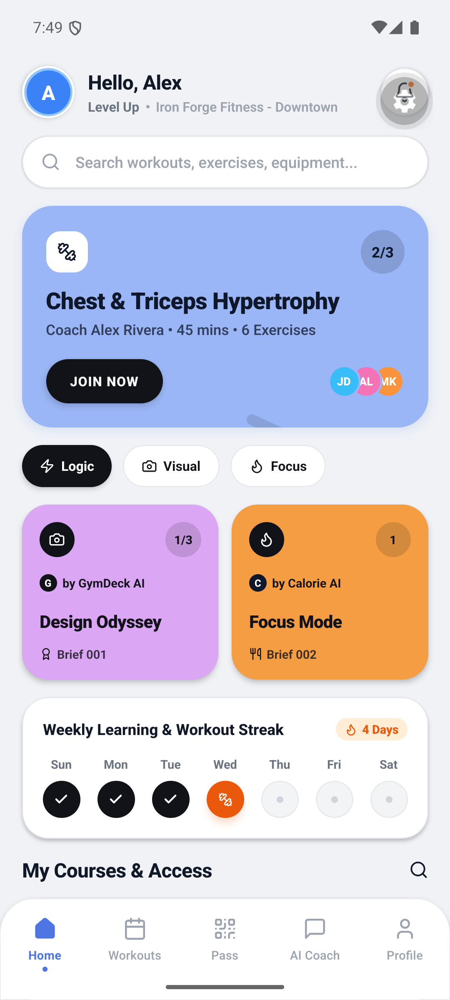
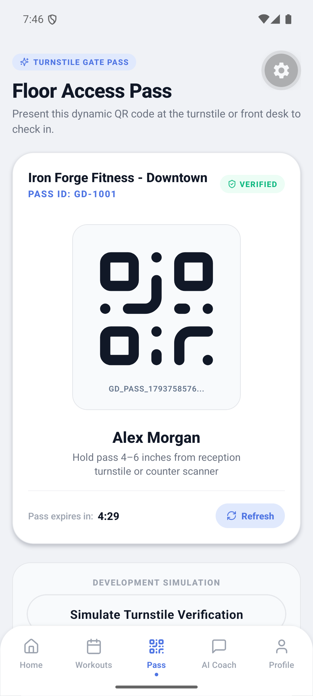
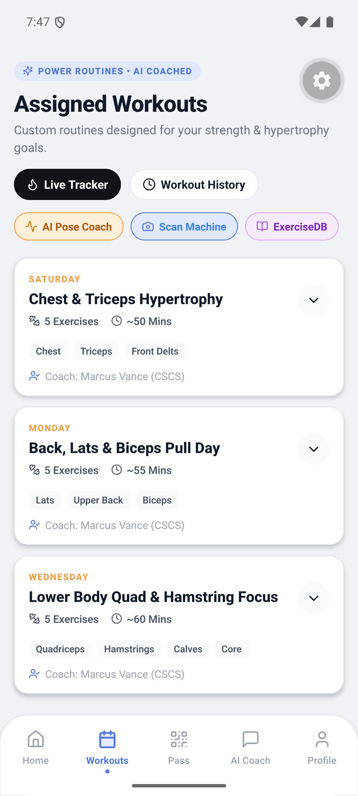
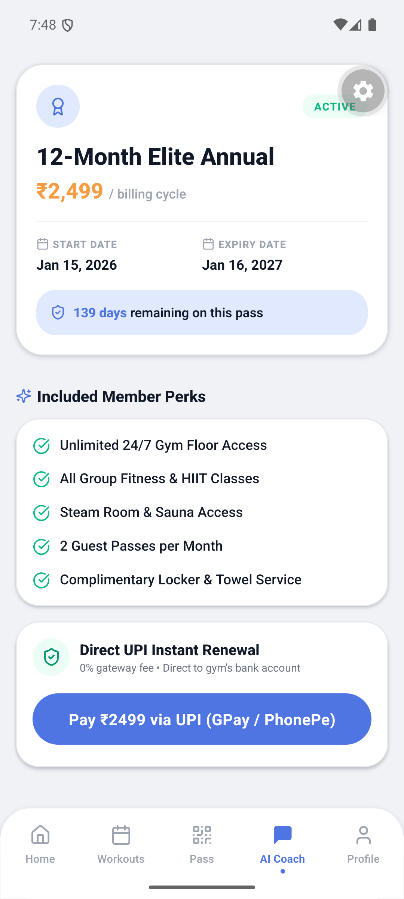

<div align="center">

#  GYMDECK

### **Unified Offline-First + Cloud-Synchronized Gym Management ERP & AI Mobile Ecosystem**

[](https://reactnative.dev/)
[](https://expo.dev/)
[](https://tauri.app/)
[](https://www.rust-lang.org/)
[](https://www.typescriptlang.org/)
[](https://tailwindcss.com/)
[](https://www.zetetic.net/sqlcipher/)
[](https://github.com/epicstudiohelpdesk-arch/GYMDECK)
[](https://opensource.org/licenses/MIT)

<p align="center">
  <b>Local-First Desktop ERP</b> • <b>Cloud-Synchronized Gateway</b> • <b>Bento Light-Theme Member App</b> • <b>Edge AI/ML Fitness Suite</b>
</p>

---

> 🏛️ **Core Architecture Principle:**  
> *"The gym creates the member. The member creates the digital account. GymDeck Cloud securely links the two."*  
> 
> ⚡ **Platform Invariant:**  
> *"Local-first. Cloud-synchronized. Server-authorized."*  
> 
> 📄 **Official Specification:** [`docs/architecture/SYSTEM-SPECIFICATION.md`](docs/architecture/SYSTEM-SPECIFICATION.md)

</div>

---

## 📱 Member Mobile App Showcase

The **GymDeck Member Mobile App** (`apps/member-mobile`) features a custom **Light-Theme Bento Design System** engineered for fluid responsiveness on both **iOS** (Dynamic Island & notch safe areas) and **Android** (navigation bars & display cutouts).

<div align="center">
  <table>
    <tr>
      <td align="center" width="25%">
        <b>🏠 Bento Home Dashboard</b><br/><br/>
        
      </td>
      <td align="center" width="25%">
        <b>🎟️ Turnstile QR Pass</b><br/><br/>
        
      </td>
      <td align="center" width="25%">
        <b>💪 Workouts & Routines</b><br/><br/>
        
      </td>
      <td align="center" width="25%">
        <b>💳 Membership & Dues</b><br/><br/>
        
      </td>
    </tr>
  </table>
</div>

### 🎨 Bento Light-Theme Aesthetic

| Token | Hex Code | Visual Role |
|---|---|---|
| **Periwinkle Primary** | `#4F75E3` / `#9BB6F6` | Primary accents, interactive pill buttons, active indicators |
| **Orchid Lilac** | `#DBA6F4` | Quick action widgets, secondary stat highlights, badges |
| **Golden Tangerine** | `#F59D42` | Daily streaks, alerts, workout energy highlights |
| **Crisp Canvas** | `#F0F2F6` | Neutral ultra-clean background with safe contrast |
| **Pure White Bento Cards** | `#FFFFFF` | Layered depth cards with soft border strokes and subtle elevation |
| **Deep Charcoal** | `#1C1D22` | High-contrast typography and icon glyphs |

---

## 📑 Table of Contents

- [Executive Overview](#-executive-overview)
- [System Architecture](#-system-architecture)
- [Member Mobile App](#-member-mobile-app)
- [AI & ML Vision Suite](#-ai--ml-vision-suite)
- [Desktop Admin ERP (Tauri + Rust)](#-desktop-admin-erp-tauri--rust)
- [Cloud Gateway & Microservices](#-cloud-gateway--microservices)
- [Security & Cryptography](#-security--cryptography)
- [Document Compression Pipeline](#-document-compression-pipeline)
- [Monorepo Directory Structure](#-monorepo-directory-structure)
- [Setup & Quickstart Guide](#-setup--quickstart-guide)
- [Automated Testing & Verification](#-automated-testing--verification)
- [Environment Variables](#-environment-variables)
- [CI/CD & Production Build Targets](#-cicd--production-build-targets)

---

## 🌟 Executive Overview

**GymDeck** is an enterprise-grade gym management ecosystem designed to solve the two biggest operational pitfalls in physical fitness facilities:
1. **Network Fragility:** Single-point cloud software failure stops turnstiles, locks out members, and halts front-desk operations during ISP outages.
2. **Disconnected Member Experiences:** Members struggle with separate apps for payments, workout tracking, nutrition guidance, and gate access.

GymDeck unifies this into a **tri-tier hybrid architecture**:
- **Offline-First Desktop ERP:** Runs locally on front-desk computers via **Tauri v2 + Rust**, storing all gym data in an AES-256 encrypted SQLCipher database. The gym stays 100% operational offline.
- **Cloud Gateway Hub:** Acts as an asynchronous bi-directional sync coordinator, serializing turnstile entries, managing memberships, and processing online payments.
- **Member Mobile Experience:** An Expo/React Native mobile application featuring instant turnstile QR access, workout logging, PT schedules, and an **on-device AI Computer Vision suite** for nutrition and exercise coaching.

---

## 🏛️ System Architecture

```
┌─────────────────────────────────────────────────────────────────────────────────────────┐
│                                    GYMDECK ECOSYSTEM                                    │
└─────────────────────────────────────────────────────────────────────────────────────────┘
                                             │
                  ┌──────────────────────────┴──────────────────────────┐
                  ▼                                                     ▼
┌───────────────────────────────────┐                 ┌───────────────────────────────────┐
│   TAURI V2 DESKTOP ERP (ADMIN)    │                 │    EXPO / REACT NATIVE MOBILE     │
│   (macOS / Windows / Linux)       │                 │         (iOS & Android)           │
│                                   │                 │                                   │
│  ┌─────────────────────────────┐  │                 │  ┌─────────────────────────────┐  │
│  │ React 19 Frontend Shell     │  │                 │  │ Bento Light-Theme UI/UX     │  │
│  │ 36 Lazy-Loaded Admin Stages │  │                 │  │ Floating Bottom Nav Dock    │  │
│  └──────────────┬──────────────┘  │                 │  └──────────────┬──────────────┘  │
│                 │ IPC Commands    │                 │                 │                 │
│  ┌──────────────▼──────────────┐  │                 │  ┌──────────────▼──────────────┐  │
│  │ Rust Core Engine            │  │                 │  │ AI/ML Computer Vision Suite │  │
│  │ - SQLCipher AES-256 DB      │  │                 │  │ - Calorie/Macro Scanner     │  │
│  │ - Dedicated Write Worker    │  │                 │  │ - Gym Equipment Classifier  │  │
│  │ - Argon2id Cryptography     │  │                 │  │ - Real-Time Pose Coach      │  │
│  │ - lopdf Document Optimizer  │  │                 │  │ - ExerciseDB 1300+ Library  │  │
│  │ - Daily 3:00 AM VACUUM      │  │                 │  └──────────────┬──────────────┘  │
│  └──────────────┬──────────────┘  │                 │                 │                 │
└─────────────────┼─────────────────┘                 └─────────────────┼─────────────────┘
                  │                                                     │
                  │ WebSocket / HTTPS Sync Hub                          │ RESTful APIs / HMAC
                  ▼                                                     ▼
┌─────────────────────────────────────────────────────────────────────────────────────────┐
│                         GYMDECK CLOUD GATEWAY & MICROSERVICES                           │
│  ┌───────────────────────┐ ┌───────────────────────┐ ┌───────────────────────────────┐  │
│  │ Multi-Tenant Sync Hub │ │ Turnstile Gate Lock   │ │ Payment Orchestration         │  │
│  │ Delta Conflict Matrix │ │ Concurrent Check-Ins  │ │ Razorpay / Stripe / UPI QR    │  │
│  └───────────────────────┘ └───────────────────────┘ └───────────────────────────────┘  │
└─────────────────────────────────────────────────────────────────────────────────────────┘
```

---

## 📱 Member Mobile App

Built on **React Native** and **Expo SDK 54+**, the Member App gives gym-goers seamless daily access to their fitness life:

### 🔐 Auth & Onboarding Suite
- **Welcome Onboarding Walkthrough:** Interactive value proposition cards showcasing AI coach features, turnstile entry, and workout planners.
- **Cloud Gym Linking:** Connects digital accounts to local physical gym memberships via Gym Code and Member PIN verification.
- **Biometric & Secure Auth:** High-assurance Login, Signup, Forgot Password, and 6-Digit OTP Email Verification.

### 🏠 Navigation & Tab Architecture
- **Floating Bento Dock:** Elevated frosted bottom dock (`borderTopRadius: 32`) with active state micro-dots, haptic feedback, and responsive padding.
- **Home Dashboard:**
  - Dynamic Member Greeting with avatar & status badges.
  - Daily Streak & Goal Progress counters.
  - Active Floor Pass Bento Card with quick turnstile trigger.
  - Interactive Bento Quick Actions: *AI Nutrition*, *Equipment Scanner*, *Pose Coach*, *Exercise Catalog*.
  - Live Gym Capacity indicator.
- **Turnstile Check-In / Floor Pass:**
  - Dynamic QR Code backed by rotating **HMAC-SHA256 signatures**.
  - 30-second live countdown timer with auto-refresh mechanism.
  - Anti-screenshot watermarking and anti-replay timestamps.
  - Recent check-in timestamps and access validation alerts.
- **Workouts & Routines:**
  - Day-by-day split scheduler (Push, Pull, Legs, Upper, Lower, Cardio).
  - Target muscle group visual tags.
  - Exercise volume, set, rep, and weight counters.
  - Personal Record (PR) celebration tracker.
- **Membership & Billing:**
  - Premium Tier card (Platinum, Gold, Silver, Student).
  - Renewal countdown and expiry notifications.
  - Outstanding dues summary card.
  - Payment history with instant PDF invoice downloads.
- **Member Profile:**
  - Personal health metrics (Weight, Height, BMI, Body Fat %).
  - Emergency contact details and locker assignments.
  - Appearance preferences (Light Bento default / Dark theme).

---

## 🤖 AI & ML Vision Suite

GymDeck integrates cutting-edge computer vision capabilities directly into the mobile experience (`apps/member-mobile/src/services/ai/`):

```
┌──────────────────────────────────────────────────────────────────────────┐
│                      GYMDECK AI / ML VISION ENGINE                       │
└──────────────────────────────────────────────────────────────────────────┘
       │                                     │                      │
       ▼                                     ▼                      ▼
┌──────────────────────────────┐ ┌──────────────────────────────┐ ┌──────────────────────────────┐
│  AI NUTRITION & CALORIES     │ │  AI EQUIPMENT CLASSIFIER     │ │  AI REAL-TIME POSE COACH     │
│  - Instant Camera Macro Scan │ │  - Machine Identification    │ │  - 33-Point Keypoint Math    │
│  - Multi-item Segmentation   │ │  - Targeted Muscle Groups    │ │  - Range-of-Motion (ROM)     │
│  - Calories, Protein, Carbs  │ │  - Video Guide & Steps       │ │  - Form Angle Validation     │
│  - Micronutrient Estimates   │ │  - Safety Precautions        │ │  - Rep Cadence Counter       │
│  - Daily Budget Auto-Log     │ │  - Free-Weight Alternatives  │ │  - Live Audio Correction     │
└──────────────────────────────┘ └──────────────────────────────┘ └──────────────────────────────┘
```

### 1. AI Calorie & Nutrition Vision Scanner (`calorieVisionService.ts`)
- Scans meal plates via live camera feed or photo gallery.
- Performs multi-item semantic segmentation (e.g., grilled chicken breast, quinoa, steamed broccoli).
- Calculates macronutrient distribution: **Calories (kcal)**, **Protein (g)**, **Carbohydrates (g)**, **Fats (g)**, and **Fiber (g)**.
- Persists daily food logs into the reactive `nutritionStore.ts`.

### 2. AI Gym Machine & Equipment Classifier (`gymMachineService.ts`)
- Instantly detects gym machines (Lat Pulldown, Smith Machine, Leg Press, Cable Crossover, Pec Deck).
- Displays primary and secondary muscles targeted in 3D-style anatomical maps.
- Provides step-by-step seat setup, pin placement, grip adjustments, and common rookie mistakes to avoid.
- Suggests alternative dumbbell and resistance band variations if the machine is occupied.

### 3. AI Real-Time Pose Coach & Rep Counter (`poseCoachService.ts`)
- Leverages edge keypoint tracking across 33 skeletal body landmarks.
- Supported exercises: **Barbell Squats**, **Pushups**, **Bench Press**, **Deadlifts**, and **Bicep Curls**.
- Calculates trigonometric joint angles in real time (e.g., knee flexion angle: depth verification at `< 90°`).
- Tracks eccentric vs. concentric phases and counts reps only upon full range of motion.
- Triggers instant visual/audio feedback for improper form (e.g., *"Keep chest up"*, *"Knees caving inward"*).

### 4. ExerciseDB Muscle Directory (`exerciseDbService.ts`)
- 1,300+ indexed strength, hypertrophy, and mobility movements.
- Filterable by target muscle (Chest, Lats, Quads, Hamstrings, Deltoids, Core), equipment (Barbell, Cable, Machine, Dumbbell), and difficulty.

---

## 🖥️ Desktop Admin ERP (Tauri + Rust)

The GymDeck Desktop Shell provides front-desk gym staff and gym owners with an offline-resilient, military-grade administrative ERP:

### ⚡ Rust Backend Engine (`src-tauri/`)
- **SQLCipher AES-256 Storage:** All member records, financial ledgers, and attendance logs are encrypted at rest with keys derived from `GYMDECK_DB_KEY`.
- **Dedicated Write Worker (`AsyncDbManager`):** Writes are serialized through an asynchronous `tokio::sync::mpsc` channel to a dedicated OS thread, completely eliminating `SQLITE_BUSY` lock contention.
- **High-Performance Read Pool:** Managed pool of 15 simultaneous read connections via `r2d2`.
- **Argon2id Key Derivation:** Industry-standard password hashing (64 MB memory, 3 iterations, 4 parallelism).
- **Automated Health Monitor:** Background daemon running every 60 seconds performing passive WAL checkpoints and 50-page incremental vacuums.
- **Automated 3:00 AM Backup:** Online `VACUUM INTO` creates non-blocking `.gymdeckbackup` snapshots with SHA-256 integrity checksums.
- **Device Trust Engine:** Generates SHA-256 machine hardware fingerprints to bind administrative sessions to authorized hardware.

### 🎛️ 36 Lazy-Loaded Admin Stages (`frontend/`)
The desktop frontend employs an optimized stage-based lazy loading architecture (47 code-split chunks):

```
DashboardWidgets      CollectFees           MemberDocuments       TrainerPerformance
Agreements            DailyCheckin          MembershipGrowth      TrainerSchedule
AllTrainers           DeviceSync            PastMembers           WelcomeOverlay
AppSettings           ExpiringMemberships   Profile               RevenueReport
AssignTrainer         GymProfile            PTClients             SendNotification
AttendanceTrends      IDProofs              PTPackages            SessionTracking
BackupRestore         ManualEntry           FreezePause           StaffRoles
```

---

## ☁️ Cloud Gateway & Microservices

The cloud gateway (`backend/`) enables secure synchronization between desktop instances and member mobile devices:

- **Turnstile Concurrency Engine (`backend/services/owner/ownerAttendanceService.ts`):** Serializes high-throughput member check-ins with database row-level locking, preventing fraudulent double-entries.
- **Sync Microservice (`backend/services/sync/syncService.ts`):** Bidirectional delta replication supporting both 3-argument and 4-argument sync protocols with timestamp-based conflict resolution.
- **Payment Gateway Orchestrator (`backend/gateway/src/routes/paymentConfig.ts`):** Centralized webhook handlers and checkout sessions for Razorpay, Stripe, and UPI QR codes.
- **Multi-Tenant Scoping:** Full database-level multi-gym isolation via enforced `gym_id` foreign keys and role-based access control (RBAC).

---

## 🔒 Security & Cryptography

| Security Domain | Mechanism | Implementation Details |
|---|---|---|
| **Database Encryption** | AES-256 (SQLCipher) | 256-bit CBC encryption with HMAC per page. Hard purge prohibited on key mismatch. |
| **Password Storage** | Argon2id & scrypt | Desktop: Argon2id (64MB/3/4). Cloud: scrypt (N=16384, r=8, p=1). Constant-time comparisons. |
| **Pass Generation** | HMAC-SHA256 Dynamic QR | Single-use time-bound tokens refreshed every 30s with anti-replay cryptographic nonces. |
| **Session Security** | OS Keyring + Keychains | Tokens stored in macOS Keychain, Windows Credential Manager, or Linux Secret Service. |
| **Memory Protection** | Zeroize on Drop | `SecureString` and cryptographic tokens zeroize their memory allocations when dropped. |
| **Brute-Force Guard** | Token-Bucket Limiter | Exponential penalty multipliers on failed attempts across auth and sensitive endpoints. |
| **Safe Error Handling** | Sanitized Serializers | Strips internal paths, queries, and cryptographic keys before error delivery. |

---

## 📦 Document Compression Pipeline

GymDeck features a two-stage document compression pipeline:

```
[User Selects Document / ID / Photo]
                  │
                  ▼
┌────────────────────────────────────────────────────────┐
│  CLIENT-SIDE (Canvas Engine — WebP Q75, max 1600px)    │
│  - Photo reduction: 40% to 70% size decrease           │
│  - PDFs bypassed to preserve multi-page fidelity       │
└─────────────────────────┬──────────────────────────────┘
                          │ Tauri IPC (Base64 Transfer)
                          ▼
┌────────────────────────────────────────────────────────┐
│  SERVER-SIDE (Rust PdfOptimizer — lopdf + flate2)      │
│  - Gate: Triggered if >200 KB and magic bytes = %PDF   │
│  - Phase 1: Orphan Object Pruning                      │
│  - Phase 2: Metadata & XMP Stripping                   │
│  - Phase 3: Embedded JPEG Re-Encoding (Q70, 1200px)    │
│  - Phase 4: SHA-256 Stream Deduplication               │
│  - Phase 5: Cross-Reference Stream Compression         │
└─────────────────────────┬──────────────────────────────┘
                          │
                          ▼
            [SQLCipher AES-256 BLOB Storage]
```

---

## 📂 Monorepo Directory Structure

```
GYMDECK/
├── apps/
│   ├── member-mobile/              # React Native & Expo Member Mobile App
│   │   ├── app/                    # Expo Router file-based screens
│   │   │   ├── (auth)/             # Login, Signup, Forgot/Reset Password, Verify OTP
│   │   │   ├── (main)/(tabs)/      # Bento Home, QR Check-In, Workouts, Membership, Profile
│   │   │   ├── (onboarding)/       # Welcome walkthrough & Gym linking
│   │   │   └── details/            # AI Hub, Nutrition, Machine Scanner, Pose Coach, Exercise DB
│   │   ├── src/
│   │   │   ├── components/         # Bento cards, Pill buttons, Dynamic QR views
│   │   │   ├── services/ai/        # Calorie Vision, Pose Tracking, Equipment Classifier
│   │   │   ├── store/              # Nutrition, Auth, and Theme state stores
│   │   │   └── theme/              # Bento tokens, color palettes, and geometry
│   │   └── package.json
│   │
│   └── owner-mobile/               # Gym Owner / Staff companion mobile app
│
├── backend/                        # Cloud Gateway & Microservices
│   ├── gateway/                    # Express 5 / TypeScript API Gateway & Routes
│   ├── services/                   # Billing, Attendance, Sync, and Member services
│   ├── shared/                     # SQL schemas, database bootstraps, and types
│   └── workers/                    # Background jobs and notification queues
│
├── frontend/                       # Desktop React 19 Frontend (Tauri WebView)
│   ├── *.jsx (36 stages)           # Lazy-loaded admin views (CollectFees, DailyCheckin, etc.)
│   ├── index.html                  # Desktop shell entrypoint
│   └── script.js                   # Navigation coordinator and stage registry
│
├── src-tauri/                      # Native Rust Desktop Core
│   ├── src/
│   │   ├── commands/               # Tauri IPC business & auth commands
│   │   ├── database/               # SQLCipher manager, migrations, async write worker
│   │   ├── encryption/             # Argon2id, SecureString zeroize wrappers
│   │   ├── sessions/               # OS Keyring manager and device trust engine
│   │   ├── utils/                  # lopdf PDF compression pipeline
│   │   ├── security_tests.rs       # 13 Automated security test suites
│   │   └── chaos_tests.rs          # 10 Automated resilience test suites
│   └── Cargo.toml
│
├── authentication/                 # Standalone Express Auth Pages (Legacy / Dev)
├── docs/                           # Architecture specifications & system docs
│   └── assets/screenshots/         # Verified application screenshots
├── infrastructure/                 # Docker, Traefik, and deployment configurations
├── package.json                    # Workspace root scripts
└── pnpm-workspace.yaml             # pnpm workspace definition
```

---

## 🚀 Setup & Quickstart Guide

### Prerequisites
- **Node.js:** `v20.0.0` or later
- **pnpm:** `v9.0.0` or later (`npm install -g pnpm`)
- **Rust & Cargo:** `1.77+` (for Tauri desktop compilation: [rustup.rs](https://rustup.rs/))
- **Mobile Environment:** [Expo Go](https://expo.dev/go) on iOS/Android, Xcode (iOS Simulator), or Android Studio (Pixel Emulator)

### 1. Repository Installation
```bash
# Clone the repository
git clone https://github.com/epicstudiohelpdesk-arch/GYMDECK.git
cd GYMDECK

# Install monorepo dependencies
pnpm install
```

### 2. Running Member Mobile App (Expo)
```bash
cd apps/member-mobile

# Start Expo development server
npx expo start

# Run directly on Android emulator
npx expo start --android

# Run directly on iOS simulator (macOS only)
npx expo start --ios
```

### 3. Running Desktop ERP (Tauri + Rust)
```bash
# Set your local database encryption key
export GYMDECK_DB_KEY=$(openssl rand -hex 32)

# Start Vite dev server and Tauri desktop window
pnpm run tauri dev
```

### 4. Running Cloud Gateway
```bash
cd backend/gateway

# Configure environment
cp .env.example .env

# Start gateway server
pnpm run dev
```

---

## 🧪 Automated Testing & Verification

GymDeck enforces strict quality criteria across the monorepo:

### 📱 Member Mobile App TypeScript Verification
```bash
cd apps/member-mobile
pnpm run typecheck
# Output: $ tsc --noEmit (0 errors)
```

### 🦀 Rust Security & Chaos Tests (23 Passing)
```bash
cd src-tauri
cargo test
```

```
23/23 tests passed (9.72s)
├── 13 Security & Enterprise Tests
│   ├── test_rate_limiter_prevents_bruteforce ............ PASSED
│   ├── test_rate_limiter_penalty_logic .................. PASSED
│   ├── test_rate_limiter_refill ......................... PASSED
│   ├── test_device_trust_fingerprint_determinism ........ PASSED
│   ├── test_trust_engine_drift_classification .......... PASSED
│   ├── test_session_create_and_revoke ................... PASSED
│   ├── test_session_lock ................................ PASSED
│   ├── test_argon2_hash_and_verify ...................... PASSED
│   ├── test_secure_string_zeroize_on_drop ............... PASSED
│   ├── test_app_config_defaults ......................... PASSED
│   ├── test_schema_migration_version_tracking ........... PASSED
│   └── test_concurrent_rate_limiter_thread_safety ....... PASSED
│
└── 10 Chaos & Resilience Tests
    ├── test_corrupted_backup_import_rejection ........... PASSED
    ├── test_schema_downgrade_detection .................. PASSED
    ├── test_incremental_vacuum_does_not_block ........... PASSED
    ├── test_panic_hook_sanitization ..................... PASSED
    ├── test_error_serialization_safety .................. PASSED
    ├── test_database_corruption_error ................... PASSED
    ├── test_rapid_fire_auth_rejection ................... PASSED
    ├── test_multi_factor_kdf_produces_different_keys .... PASSED
    ├── test_wal_mode_pragma_applies_correctly ........... PASSED
    └── test_config_production_mode_detection ............ PASSED
```

---

## ⚙️ Environment Variables

Copy `.env.example` to `.env` in respective application directories:

| Variable | Target | Purpose | Generation |
|---|---|---|---|
| `GYMDECK_DB_KEY` | Desktop (Rust) | SQLCipher AES-256 database encryption key | `openssl rand -hex 32` |
| `SESSION_SECRET` | Backend / Express | Session cookie encryption & HMAC signing | `openssl rand -hex 64` |
| `EXPO_PUBLIC_API_URL` | Member Mobile | Base URL for GymDeck Cloud Gateway | `https://api.gymdeck.app` |
| `EXPO_PUBLIC_AI_API_KEY` | Member Mobile | Fallback cloud API key for AI vision | *Optional for cloud vision* |
| `RAZORPAY_KEY_ID` | Backend | Online membership payment processor | From Razorpay Dashboard |
| `STRIPE_SECRET_KEY` | Backend | International subscription billing | From Stripe Dashboard |

---

## 🚀 CI/CD & Production Build Targets

Automated build matrices via GitHub Actions (`.github/workflows/`):

| Platform | Target Artifact | Compiler Profile | Code Signing |
|---|---|---|---|
| **macOS (Apple Silicon)** | `.dmg` | `opt-level = "z"`, `lto = true` | Apple Developer ID |
| **macOS (Intel x64)** | `.dmg` | `opt-level = "z"`, `lto = true` | Apple Developer ID |
| **Windows 10/11** | `.msi` + `.exe` | `opt-level = "z"`, `lto = true` | Windows Authenticode |
| **Linux (Ubuntu)** | `.AppImage` | `opt-level = "z"`, `lto = true` | GPG signature |
| **Android** | `.apk` / `.aab` | Expo EAS / Gradle Release | Android Keystore |
| **iOS** | `.ipa` (TestFlight / App Store) | Expo EAS / Xcode Archive | Apple Distribution Certificate |

---

<div align="center">

### Built with ❤️ for modern gym owners and fitness communities worldwide.

**GymDeck Engineering Team** • [Report Issues](https://github.com/epicstudiohelpdesk-arch/GYMDECK/issues) • [View Architecture Docs](docs/architecture/SYSTEM-SPECIFICATION.md)

</div>
